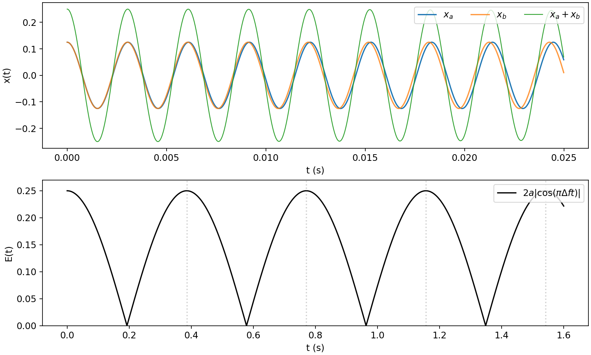

# Distinguer les battements entre deux sons de leur décroissance

> **Périmètre du brouillon.** Signaux construits à amplitude constante, contrôles numériques et médias originaux. La revue technique humaine, la relecture linguistique, les essais par des apprenants et la vérification du HTML déployé restent à faire. Il ne s’agit ni d’un nouveau rendu du moteur de GA, ni d’un diagnostic sur une guitare physique, ni d’un essai d’écoute.

## La question du projet

Un agent d’analyse de guitare constate une baisse du niveau sur une fenêtre courte et annonce un amortissement plus rapide. Un autre mécanisme pourrait-il produire la même observation ? L’[équation des battements d’OpenStax](https://openstax.org/books/university-physics-volume-1/pages/17-6-beats) découle de l’addition de deux cosinus. Nous utilisons cette identité mathématique avec des signaux construits indépendamment et des exercices originaux. Aucun schéma, activité ou enregistrement tiers n’est reproduit.

Prenez les fréquences 327.031956626 Hz et 329.627556913 Hz, construites dans [WML-004](../../world-music-languages/en/wml-004-preserve-intonation-beyond-pitch-classes.md). Chaque composante a une amplitude crête fixe `a=0.125`, une phase initiale de cosinus de 0 et une fréquence d’échantillonnage de 44100 Hz. Aucune composante ne perd d’amplitude dans le modèle mathématique sans fondu. Leur somme variable fournit un contre-exemple à l’inférence proposée.

## 1. Déduire la somme avant de nommer son enveloppe

Écrivez `x_a(t)=a*cos(2*pi*f_a*t)` et `x_b(t)=a*cos(2*pi*f_b*t)`. Leur somme vaut `2*a*cos(pi*(f_b-f_a)*t)*cos(2*pi*((f_a+f_b)/2)*t)`. La différence est de 2.595600287 Hz et la moyenne de 328.329756769 Hz. La comparaison numérique des deux expressions sur quatre secondes est restée dans la tolérance absolue déclarée `1e-10`.

Le modulateur signé a pour fréquence `abs(f_b-f_a)/2`, soit environ 1.297800144 Hz. L’enveloppe **non signée** vaut `2*a*abs(cos(pi*(f_b-f_a)*t))`. Ses crêtes reviennent à la fréquence de différence, soit environ 2.595600287 Hz. Oublier la valeur absolue produit une erreur d’interprétation d’un facteur deux.

### Exercice pratique 1 : nommer la récurrence mesurée

Pour ces fréquences, calculez la période de récurrence de l’enveloppe non signée, puis comparez la fréquence du modulateur signé à la fréquence de récurrence des crêtes non signées.

> **Réponse :** `T=1/abs(f_b-f_a)` vaut environ 0.385267333 seconde. La fréquence du modulateur signé est d’environ 1.297800144 Hz ; les crêtes non signées reviennent à environ 2.595600287 Hz. Les changements de signe inversent la phase de la porteuse sans rendre négatif le module de l’amplitude.

## 2. Une enveloppe décroissante peut remonter sans apport d’énergie

L’enveloppe non signée part de 0.25, atteint son premier zéro vers 0.192633666 seconde, puis retrouve sa crête vers 0.385267333 seconde. L’amplitude de chaque composante reste de 0.125. Les annulations et renforcements modifient la somme sans introduire d’amortissement exponentiel des composantes.

Le graphique supérieur montre les premières 0.025 secondes du modèle sans fondu. Le graphique inférieur montre son enveloppe non signée ; les pointillés marquent les périodes de récurrence successives. Cette figure ne représente pas la forme d’onde du WAV exporté avec des fondus aux extrémités. Un zéro de l’enveloppe mathématique ne garantit pas non plus une valeur RMS nulle sur une fenêtre de durée finie.

### Exercice pratique 2 : rejeter une conclusion d’amortissement non étayée

Un agent ajuste une droite de décroissance uniquement entre la crête initiale et le premier minimum de l’enveloppe. Pourquoi cet intervalle ne permet-il pas d’établir un amortissement des composantes dans cet exemple ?

> **Réponse :** Les deux composantes ont une amplitude constante, mais leur somme s’annule près du premier minimum, puis remonte. L’intervalle choisi omet cette remontée. Le modèle fournit donc un contre-exemple à l’assimilation de toute enveloppe décroissante à une perte d’énergie des composantes ; il ne diagnostique pas la cause d’un enregistrement particulier de guitare physique.

## 3. Préciser la fenêtre et le contrôle

Le [relevé de mesure](../../../../code/streeling/evidence/intonation-listening-2026-10-22/beats.json) utilise des fenêtres RMS nominales de 20 ms centrées sur `T`, `1.5*T` et `2*T`. Pour chaque fenêtre, l’indice de début et l’indice de fin exclu sont les plafonds des temps correspondants multipliés par 44100. Cette convention explicite d’intervalle semi-ouvert évite de modifier silencieusement les échantillons inclus.

Par rapport à la première fenêtre, la fenêtre d’interférence destructive baisse de 26.357732143 dB ; la fenêtre de remontée diffère de +0.000373071 dB. Avant la mesure, le plan exigeait un creux d’au moins 10 dB et une remontée à moins de 1 dB du niveau initial. Les deux contrôles passent. Remplacer la seconde fréquence par la première, en conservant les mêmes fenêtres, ne donne qu’une variation de +0.000087429 dB à l’emplacement de l’ancien creux. L’échantillonnage de la porteuse sur une durée finie explique pourquoi le rapport de ce contrôle sur une fenêtre courte n’est pas exactement de zéro dB.

### Exercice pratique 3 : interpréter la comparaison

La fenêtre d’interférence destructive est à -26.357732143 dB par rapport à la première, et la fenêtre ultérieure à +0.000373071 dB. Quels critères annoncés à l’avance sont satisfaits ? Qu’apporte le contrôle à fréquences égales ?

> **Réponse :** Le creux dépasse 10 dB et le niveau de la fenêtre de remontée est à moins de 1 dB de celui de la première : les deux critères sont donc satisfaits. Le contrôle à fréquences égales ne présente pas ce creux important aux mêmes fenêtres, ce qui étaye le rôle des interférences entre fréquences dans cette comparaison construite. Cela n’établit pas le mécanisme d’un enregistrement physique non mesuré.

## 4. Distinguer les signaux mathématiques des fichiers d’écoute

Le dossier contient une [illustration originale du mélange sur quatre secondes](../../../../code/streeling/evidence/intonation-listening-2026-10-22/two-tone-illustration.wav). Elle conserve les amplitudes des composantes et applique des fondus sur 441 échantillons, soit 10 ms, à chaque extrémité. Chaque fondu inclut ses points d’extrémité. Les fenêtres mesurées sont en dehors de ces fondus. Le WAV est en PCM16 mono, tandis que les équations tracées et les fenêtres RMS enregistrées utilisent des signaux en virgule flottante sans fondu.

Les fichiers séparés [son A](../../../../code/streeling/evidence/intonation-listening-2026-10-22/tone-a.wav) et [son B](../../../../code/streeling/evidence/intonation-listening-2026-10-22/tone-b.wav) durent chacun une seconde. Leur RMS en virgule flottante après fondu est ajusté à 0.05 avant quantification. Ces fichiers de sons isolés sont préparés pour une tâche proposée de discrimination séquentielle ; le mélange simultané illustre les interférences. Aucun de ces fichiers n’a été reproduit ni écouté dans cette analyse.

Le [relevé des fichiers](../../../../code/streeling/evidence/intonation-listening-2026-10-22/audio-assets.json) précise l’arrondi au pair le plus proche de `sample*32768`, le décodage PCM16 signé par division par 32768, les empreintes et les erreurs de reconstruction. L’erreur absolue maximale de quantification est au plus de `0.5/32768`. Égaliser numériquement les RMS n’établit ni une égalité du niveau sonore perçu ni le niveau réel de restitution.

### Exercice pratique 4 : choisir le fichier adapté

Quel fichier illustre les battements simultanés, et quelle paire convient à une question séquentielle sur le son le plus aigu ? L’égalisation RMS annoncée établit-elle une égalité du niveau sonore perçu ?

> **Réponse :** Le mélange de quatre secondes illustre les battements simultanés. Les sons séparés d’une seconde conviennent à la question séquentielle. Il s’agit de stimuli et de tâches différents. L’égalisation RMS en virgule flottante et la vérification PCM établissent la préparation numérique ; l’égalité du niveau sonore perçu et l’étalonnage de la restitution restent non mesurés.

## 5. Conserver le résultat d’échec du moteur

Le précédent [dossier d’exécution du moteur de guitare](../../../../code/streeling/evidence/guitar-runtime-2026-10-22/README.md) mesurait un gain de 0.114166150 dB pour un candidat, face à un seuil requis de 1 dB sur la décroissance. Ce candidat a échoué. Un nouveau contre-exemple construit ne peut modifier ni les anciens échantillons, ni la règle, ni le verdict.

Pour un futur enregistrement physique ou issu du moteur, déclarez la composante ou la bande cible, la fenêtre d’analyse et les contrôles avant de comparer la décroissance. Vérifiez si une remontée du niveau, des partiels en interaction ou une autre fenêtre de mesure remettent en cause le mécanisme proposé. Ce sont des contrôles de suivi possibles, pas une affirmation selon laquelle les interférences ont causé l’échec précédent. [COG-004](../../cognitive-science/en/cog-004-score-a-pitch-discrimination-task.md) examine séparément ce qu’un score d’écoute pourrait établir.

### Exercice pratique 5 : délimiter la révision de l’agent

Un agent voit la nouvelle simulation et fait passer l’ancien candidat du statut d’échec à celui de réussite. Que doit indiquer son rapport corrigé ?

> **Réponse :** L’ancien candidat reste en échec : 0.114166150 dB est inférieur au seuil requis de 1 dB. Le nouveau modèle à amplitude constante montre qu’une enveloppe décroissante sur une fenêtre courte peut résulter d’interférences. Il motive un suivi contrôlé sur les enregistrements réels ; il ne renverse pas l’ancien verdict et n’établit ni une cause physique ni un bénéfice perceptif.
